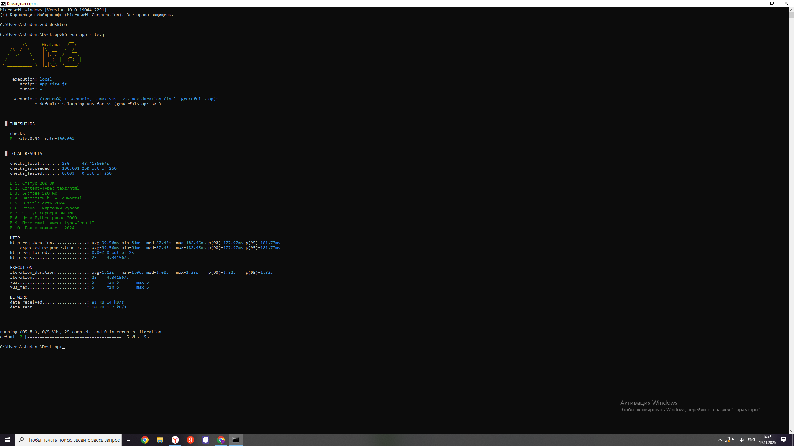

# Проект: Сайт EduPortal и k6-тесты

В данном репозитории находятся файлы для сдачи задания:
- `index.html` — исходный код тестируемого сайта.
- `app_site.js` — скрипт с 10 автотестами для k6.

## Результаты тестирования
Все 10 проверок успешно пройдены (100%).

